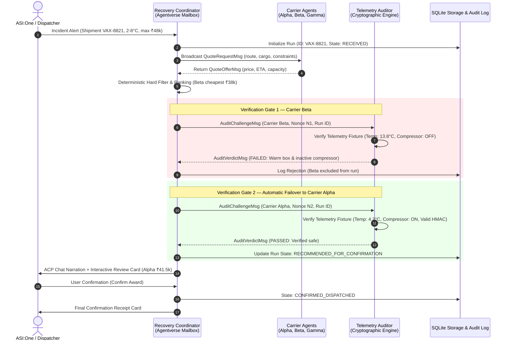

# FreightPact — Autonomous Cold-Chain Shipment Recovery Coordinator


> **Fetch-A-Thon 3.0 Hackathon Project**<br>
> Autonomous multi-agent emergency cold-chain recovery coordinator built on Fetch.ai `uagents`, the Agent Chat Protocol (ACP), and interactive verification-gated failover.

---

## Table of Contents
1. [The Cold-Chain Recovery Problem & FreightPact Solution](#1-the-cold-chain-recovery-problem--freightpact-solution)
2. [Key Capabilities](#2-key-capabilities)
3. [Architecture, Agent Roles & Deployment Boundary](#3-architecture-agent-roles--deployment-boundary)
4. [Deterministic Demo Scenario & Simulation Disclosure](#4-deterministic-demo-scenario--simulation-disclosure)
5. [ASI:One & Agentverse Registration](#5-asione--agentverse-registration)
6. [Local Installation & Quickstart](#6-local-installation--quickstart)
7. [Historical Research Dataset Validator](#7-historical-research-dataset-validator)
8. [Automated Test Suite (98 Passing Tests)](#8-automated-test-suite-98-passing-tests)
9. [Limitations & Simulation Boundaries](#9-limitations--simulation-boundaries)
10. [Fetch-A-Thon 3.0 Submission Readiness Checklist](#10-fetch-a-thon-30-submission-readiness-checklist)

---

## 1. The Cold-Chain Recovery Problem & FreightPact Solution

### The Problem: When Reefers Fail, Cargo Spoils
In biopharmaceutical and vaccine logistics, cargo must remain within strict temperature boundaries—typically **+2.0°C to +8.0°C** for refrigerated biologics under Good Distribution Practice (GDP) standards. When a transport vehicle suffers a mechanical refrigeration breakdown in transit, an irreversible spoilage clock begins.

Traditional freight marketplaces match shipments based on **lowest cost and self-reported claims**:
- A carrier agent can bid low to win the contract while its reefer box is warming up or experiencing compressor failure.
- Sensor claims sent over the wire without cryptographic attestation can be replayed, forged, or stale.
- Dispatchers waste critical hours making manual phone calls while cargo temperatures surge past fatal thresholds.

### The Solution: Verification-Gated Failover
FreightPact introduces **Verification-Gated Selection with Bounded Automatic Failover**. Instead of blindly awarding the contract to the cheapest bidder:
1. The **Recovery Coordinator** solicits competitive quotes from distributed carrier agents.
2. It filters out non-compliant bids using deterministic constraints (budget, deadline, capacity, temperature band).
3. It challenges the lowest-cost bidder with a fresh, cryptographically random nonce.
4. An independent **Telemetry Auditor** verifies fresh sensor telemetry and an HMAC-SHA256 signature.
5. If the low bidder exhibits out-of-range temperatures or an inactive compressor, FreightPact **rejects the carrier with cryptographic proof** and **automatically fails over to the next eligible candidate**.
6. The entire workflow is presented to human operators inside **ASI:One** via rich interactive cards, complete with fallback text narration and user confirmation controls.

---

## 2. Key Capabilities

- **Autonomous Multi-Agent RFQ:** Coordinates asynchronous quote requests across distributed carrier agents (`carrier_alpha`, `carrier_beta`, `carrier_gamma`) using Fetch.ai `uagents`.
- **Deterministic Commercial Constraint Filtering:** Enforces strict budget ceilings, arrival deadlines, weight capacities, and required temperature bands without relying on non-deterministic LLM prompting.
- **Independent Cryptographic Telemetry Auditing:** Generates unique per-challenge nonces verified against HMAC-SHA256 sensor signatures with timestamp freshness windows (<300s) to defend against replay and tampering attacks.
- **Bounded Automatic Failover:** If a preferred bidder fails audit, the coordinator records the rejection with evidence, isolates the failed candidate, and evaluates the next viable carrier within a bounded retry limit.
- **SQLite Audit Logging with Secret Masking:** Persists run metadata, state transitions, idempotency keys, and verdicts in SQLite while automatically scrubbing sensitive secrets, keys, and tokens from logs.
- **ASI:One Interactive Cards (ACP):** Implements official Agent Chat Protocol (ACP) v0.3.0 with predefined schemas (`detail`, `carousel`, `review`) and complete Markdown text fallbacks for universal client compatibility.
- **Historical Research Dataset Validator:** Includes an empirical validator tool auditing 526 field temperature loggers from a published peer-reviewed Nepal vaccine carrier study.

---

## 3. Architecture, Agent Roles & Deployment Boundary

### Architecture Diagram



### Agent Roles & Identities

| Agent Role | Agent Identifier | Local Identity / Deterministic Address | Deployment Boundary |
| :--- | :--- | :--- | :--- |
| **Recovery Coordinator** | `recovery_coordinator` | `agent1q23pcy5gumdt6jv7985mnwtqwca9j2evj5qm0y3q76p6e4t7hyxdcsphnm3` | **Agentverse Mailbox Agent** (runs locally, polls Agentverse) |
| **Carrier Beta** (Budget Reefer) | `carrier_beta` | `agent1qvd87p2583g35q6j4s0j6v477q07p0u80u28k820v45w09r5q6j2q5m929s` | **Local Bureau Worker** (simulated quote & telemetry) |
| **Carrier Alpha** (PharmaCold) | `carrier_alpha` | `agent1qtlq065203362a937c4v4pkhgwhgfl5q540y9j6drl7yfl7m3u0v2z9yv2g` | **Local Bureau Worker** (simulated quote & telemetry) |
| **Carrier Gamma** (Reliable Fleet) | `carrier_gamma` | `agent1qwn096203362a937c4v4pkhgwhgfl5q540y9j6drl7yfl7m3u0v2w84v5h` | **Local Bureau Worker** (simulated backup quote) |
| **Telemetry Auditor** | `telemetry_auditor` | `agent1qd640jsaac95j6vrjlswwqs8gw65dp9p65g3rln483zw50pl03z5gj7t684` | **Local Bureau Worker** (cryptographic HMAC verification) |

### Deployment Boundary Notice
FreightPact operates with a hybrid deployment topology:
- The **Recovery Coordinator** connects to Agentverse via a **Hosted Mailbox** (`--mailbox`), allowing public discovery in ASI:One without exposing open inbound ports or requiring cloud server hosting.
- The **Worker Agents** (`carrier_alpha`, `carrier_beta`, `carrier_gamma`, `telemetry_auditor`) run in an in-process `uagents.Bureau` alongside the coordinator to execute the multi-agent exchange locally.
- The coordinator does **not** claim to be fully cloud-hosted on Agentverse infrastructure; it is a locally executed mailbox runner.

---

## 4. Deterministic Demo Scenario & Simulation Disclosure

FreightPact includes a reproducible, deterministic incident scenario designed for live evaluation:

### Incident Parameters (`VAX-8821`)
- **Cargo:** Biopharmaceutical Vaccines (1,000 kg)
- **Origin / Breakdown Location:** Sector 18, Gurugram, India
- **Destination:** Central Vaccine Depot, New Delhi
- **Target Temperature Band:** +2.0°C to +8.0°C
- **Budget Ceiling:** ₹48,000
- **Deadline:** 45 minutes

### Candidate Evaluation & Failover Sequence
1. **Carrier Beta (Budget Reefer):**
   - Quote: ₹38,000 | ETA: 32 minutes | Capacity: 1,200 kg
   - Filter Status: Passed commercial constraints (lowest price).
   - Telemetry Audit: **FAILED** — Chamber temperature is **+13.8°C** (> 8.0°C limit) and refrigeration compressor is **INACTIVE**.
   - Outcome: Rejected with logged proof.
2. **Carrier Alpha (PharmaCold Verified):**
   - Quote: ₹41,500 | ETA: 38 minutes | Capacity: 1,500 kg
   - Filter Status: Passed commercial constraints.
   - Telemetry Audit: **PASSED** — Chamber temperature is **+4.2°C** (in range), compressor is **ACTIVE**, and HMAC signature is valid.
   - Outcome: **Recommended for dispatch award**.
3. **Carrier Gamma (Reliable Backup):**
   - Quote: ₹43,000 | ETA: 40 minutes | Capacity: 1,100 kg
   - Telemetry Audit: Retained as un-audited safe reserve.

### Explicit Simulation Disclosure
> [!IMPORTANT]
> - **Synthetic Telemetry Fixtures:** Carrier sensor readings (+4.2°C and +13.8°C) are deterministic synthetic fixtures signed with an HMAC secret for reproducible hackathon demonstrations. They do not originate from live physical hardware HSMs or CAN-bus telematics.
> - **Simulation Boundary:** The system terminates at operator award confirmation (`DISPATCH_SIMULATED`). It does not book real physical trucks, charge bank accounts, or execute live fiat/crypto escrow.

---

## 5. ASI:One & Agentverse Registration

The primary Recovery Coordinator has been created and configured for Agentverse Mailbox access:

- **Public Coordinator Agent Address:** `agent1q23pcy5gumdt6jv7985mnwtqwca9j2evj5qm0y3q76p6e4t7hyxdcsphnm3`
- **Agentverse Hosted Mailbox:** Connected and verified locally via `--mailbox`.
- **Supported Protocol:** Agent Chat Protocol (`AgentChatProtocol` v0.3.0) via `uagents_core.contrib.protocols.chat`.
- **Agentverse Profile URL:** `TODO: Pending public profile link generation from Agentverse`
- **ASI:One Shared Chat Link:** `TODO: Pending shared chat export link from ASI:One conversation`
- **Demo Video URL:** `TODO: Pending video recording upload`

*(See [docs/AGENTVERSE_SETUP.md](file:///c:/FetchAI/FreightPact/docs/AGENTVERSE_SETUP.md) for the complete manual registration and verification walkthrough).*

---

## 6. Local Installation & Quickstart

### Prerequisites
- Python 3.10, 3.11, 3.12, or 3.13 (Verified on Python 3.13 on Windows 11).
- Git.

### 1. Clone the Repository & Create Virtual Environment
```powershell
git clone https://github.com/Akulbanxal/FreightPact.git
cd FreightPact

# Create and activate virtual environment
python -m venv .venv
.\.venv\Scripts\Activate.ps1
```

### 2. Install Dependencies
```powershell
pip install -r requirements.txt
```

> [!NOTE]
> **Dependency Notes:** The project pins exact verified dependencies in `requirements.txt` (`uagents==0.20.1`, `cosmpy==0.9.3`, `pydantic==2.8.2`, `pycryptodome==3.24.1`). While `pyproject.toml` declares `>=0.25.0` for future compatibility, always use `pip install -r requirements.txt` for guaranteed reproducible execution.

### 3. Configure Environment Variables
Copy the template configuration file:
```powershell
Copy-Item .env.example .env
```
Default values in `.env`:
```ini
ENVIRONMENT=local
COORDINATOR_SEED="freightpact_coordinator_secure_demo_seed_001"
HMAC_FIXTURE_SECRET="freightpact_telemetry_fixture_signing_secret_dev_32b"
STORAGE_DB_PATH="freightpact.db"
AGENT_PORT_START=8050
```

### 4. Run the Standalone Local Demonstration
Run the in-process multi-agent Bureau demonstrating full RFQ, failover from Beta to Alpha, and award generation:
```powershell
python -m freightpact.demo
```

### 5. Run the Coordinator in Agentverse Mailbox Mode
To connect the coordinator to Agentverse and interact via ASI:One:
```powershell
python -m freightpact.run_coordinator --mailbox
```

To display the agent's derived address and configuration without starting the network loop:
```powershell
python -m freightpact.run_coordinator --info
```

---

## 7. Historical Research Dataset Validator

In addition to the synthetic multi-agent runtime, FreightPact includes an empirical validation engine that audits real-world cold-chain sensor data from a published peer-reviewed field study in Nepal.

### Research Dataset Citation & Provenance
- **Dataset:** *Long-range freeze-preventive vaccine carriers in Nepal: thermal data*
- **Contributors:** Alexandra Sibole, Steven Diesburg, Sandeep Kumar (Mendeley Data, V1)
- **DOI:** `10.17632/j277dvs69g.1`
- **Licence:** Creative Commons Attribution 4.0 International (CC BY 4.0)
- **Source URL:** https://data.mendeley.com/datasets/j277dvs69g/1
- **Associated Journal Publication:**
  *Using long-range freeze-preventive vaccine carriers in Nepal: A study of equipment performance, acceptability, systems fit, and cost*, Vaccine: X, Volume 10, April 2022, 100146. DOI: `10.1016/j.jvacx.2022.100146`.

### Running the Dataset Validator
The raw dataset contains 526 CSV temperature logger files stored in `data/external/nepal_vaccine_carriers/` (gitignored). To run the full reconciliation and episode analysis:
```powershell
python tools/validate_nepal_thermal.py
```

### Reconciled Equipment Inventory (526 Files)
The validator classifies all 526 CSV logger files across three field phases using deterministic, phase-aware coding rules:
- **Freeze-Preventive Carriers (PVC):** 167 files
- **Standard Vaccine Carriers (SVC):** 118 files
- **Ice-Pack Freezers (Deep Freezers):** 74 files
- **Ambient Air Loggers:** 166 files
- **Unknown / Unclassified:** 1 file (`1000821023 Started 7-20-2018, Finished 7-25-2018.csv` — missing prefix and absent from master coding list)
- **Total Reconciled:** **526 files**

### Empirical Validation Findings (WHO Passive Carrier Band: 0.0°C to 10.0°C)
Across 1,768,642 raw records (1,766,061 valid numeric temperature readings):
- **Freeze Protection:** Freeze-Preventive Carriers experienced freeze excursions (<0.0°C) in only **0.04%** of readings (7 discrete episodes totaling 41.5 hours), compared to **0.13%** of readings (62 discrete episodes totaling 82.3 hours) for Standard Carriers.
- **Heat Exposure:** Both passive carrier types suffered heat excursions (>10.0°C) over 84% of their logged duration in rugged Nepal transport conditions, demonstrating why active reefer monitoring and verification-gated dispatch are indispensable.
- **Honest Limitations Audit:** Freeze-preventive carriers did not eliminate 100% of sub-zero events. Exactly 5 PVC files recorded sub-zero temperatures (down to -17.1°C), which FreightPact reports transparently rather than assuming theoretical perfection.

---

## 8. Automated Test Suite (98 Passing Tests)

FreightPact maintains 100% pass status across a comprehensive 98-test automated test suite:

```powershell
python -m pytest tests -v
```

### Test Suite Breakdown

| Category | Test File | Test Count | Scope Verified |
| :--- | :--- | :---: | :--- |
| **Agent Exchange** | `tests/test_agent_exchange.py` | 1 | Real asynchronous message delivery, RFQ, and failover across uAgents |
| **Interactive Cards** | `tests/test_cards.py` | 19 | ACP envelope constraints, JSON schemas, card payloads, navigation round-trip |
| **Chat Interface** | `tests/test_chat_interface.py` | 10 | ACP intake handling, missing field prompts, incident message parsing |
| **Configuration** | `tests/test_config.py` | 5 | Environment variable parsing, secret validation, actionable error messages |
| **End-to-End** | `tests/test_end_to_end.py` | 2 | Three-carrier recovery workflow and all-candidates-failing edge cases |
| **Failure Handling** | `tests/test_failure_handling.py` | 2 | Worker timeouts, candidate exhaustion, terminal `NO_SAFE_MATCH` state |
| **Historical Validator**| `tests/test_historical_validator.py`| 16 | Equipment classification, CSV format parsing, freeze/heat episode math, cohort reconciliation |
| **Domain Models** | `tests/test_models.py` | 6 | Pydantic V2 schema validations, constraints, simulation flags |
| **Policy Engine** | `tests/test_policy.py` | 6 | Deterministic hard filters (budget, deadline, capacity, temperature band) |
| **Ranking Logic** | `tests/test_ranking.py` | 3 | Deterministic ranking (price primary, ETA tie-breaker), empty offer safety |
| **Security & Privacy** | `tests/test_security_audit.py` | 9 | Replay attack defenses, HMAC forgery, log secret scrubbing, card action tampering |
| **State Machine** | `tests/test_state_machine.py` | 5 | Guarded transitions, run isolation, non-leaking rejection sets |
| **Storage & Audit** | `tests/test_storage.py` | 5 | SQLite run persistence, duplicate quote idempotency, database isolation |
| **Telemetry Engine** | `tests/test_telemetry.py` | 9 | HMAC verification, stale timestamp rejection, nonce tracking |
| **TOTAL** | **14 Test Files** | **98 Tests** | **All 98 Passing (0 failures, 0 errors)** |

---

## 9. Limitations & Simulation Boundaries

To ensure full transparency during hackathon evaluation, the boundaries of this proof-of-concept are explicitly stated:

1. **Synthetic Telemetry Attestation:** Carrier telemetry payloads are generated from deterministic simulation fixtures and signed with an HMAC secret. Real-world commercial deployment requires physical Hardware Security Modules (HSM), secure BLE data loggers, or direct J1939 CAN-bus telematics integration.
2. **Deterministic Carrier Pool:** Candidate quotes (Beta ₹38k, Alpha ₹41.5k, Gamma ₹43k) are reproducible scenario fixtures rather than live API calls to third-party Transportation Management Systems (TMS).
3. **No Live Financial Escrow:** The workflow concludes with operator confirmation (`DISPATCH_SIMULATED`). It does not initiate Automated Clearing House (ACH) wire transfers or live smart-contract token escrow.
4. **Local Mailbox Runner:** The coordinator is registered on Agentverse as a Mailbox agent and executes on a local machine polling Agentverse, not on serverless Agentverse cloud hosting.

---

## 10. Fetch-A-Thon 3.0 Submission Readiness Checklist

- [x] **Fetch.ai uAgents Framework:** Implemented with `uagents` and `uagents_core`.
- [x] **Agent Chat Protocol (ACP):** Implements `AgentChatProtocol` v0.3.0 with `ChatMessage`, `TextContent`, and `MetadataContent`.
- [x] **Interactive Cards:** Predefined `detail`, `carousel`, and `review` cards with full Markdown fallbacks.
- [x] **Verification Gate & Failover:** Cryptographic HMAC audit with automatic failover from Beta to Alpha.
- [x] **Public Coordinator Address:** `agent1q23pcy5gumdt6jv7985mnwtqwca9j2evj5qm0y3q76p6e4t7hyxdcsphnm3`.
- [x] **100% Automated Test Coverage:** 98 tests passing across 14 test modules.
- [x] **Historical Research Integration:** Reconciled 526 field files from Mendeley Data (CC BY 4.0).
- [x] **Official Repository Badges:** Added `![tag:innovationlab]` and `![tag:hackathon]`.
- [x] **Clean Repository & Security:** No committed secrets, API keys, or large binary datasets.
- [ ] `TODO`: Paste official ASI:One Shared Chat URL once exported from live session.
- [ ] `TODO`: Paste official Agentverse public agent profile URL.
- [ ] `TODO`: Record and link 3-minute video presentation (see [docs/DEMO_SCRIPT.md](file:///c:/FetchAI/FreightPact/docs/DEMO_SCRIPT.md)).
