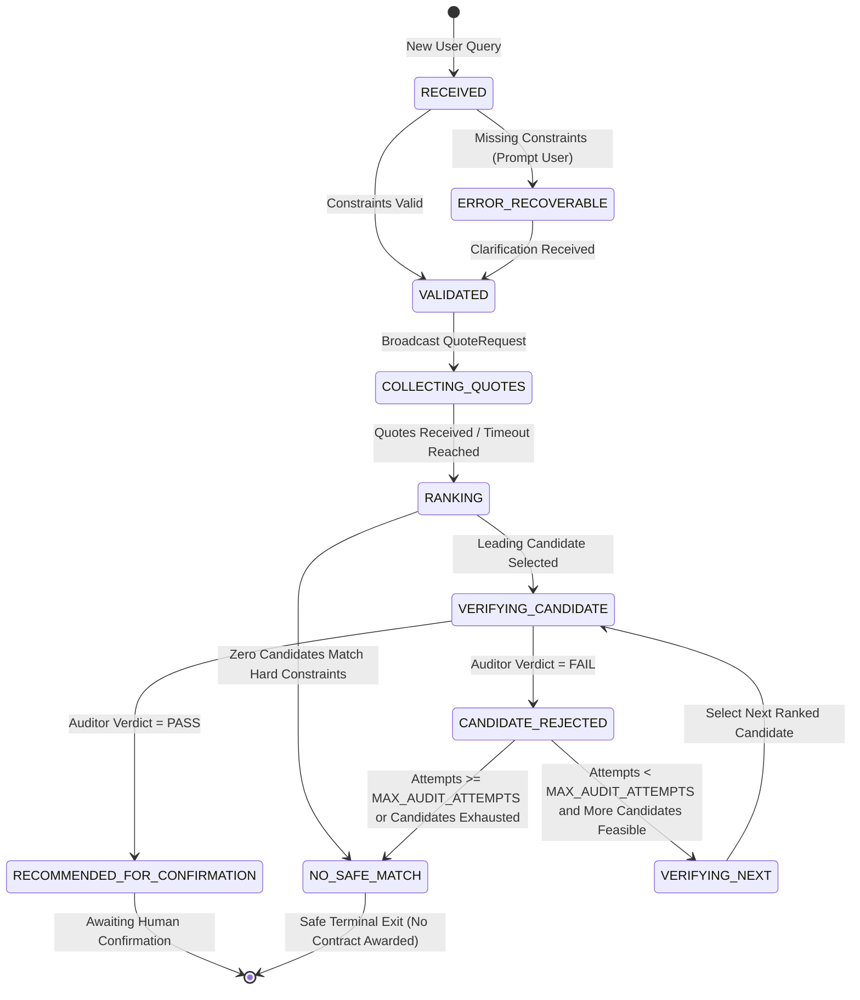

# FreightPact — Technical Architecture & Message Flow

This document details the multi-agent message sequence, state machine transitions, and component interactions in FreightPact.

---

## 1. Multi-Agent Message Sequence

The following Mermaid sequence diagram illustrates the complete workflow: from incident initiation in ASI:One, through multi-agent quote collection, deterministic ranking, verification challenge, failover from compromised carrier Beta, to the recommendation of verified carrier Alpha.

```mermaid
sequenceDiagram
    autonumber
    actor Dispatcher as Logistics Dispatcher (ASI:One)
    participant Coord as Recovery Coordinator Agent
    participant Policy as Deterministic Policy Module
    participant Beta as Carrier Beta (Cheapest)
    participant Alpha as Carrier Alpha (Safe)
    participant Auditor as Telemetry Auditor Agent

    Dispatcher->>Coord: ChatMessage (Incident: VAX-8821, +2°C..+8°C, max ₹48k, 45m)
    Note over Coord: Parse request & assign unique run_id<br/>State: RECEIVED -> VALIDATED
    Coord->>Dispatcher: ChatAcknowledgement (msg_id)

    rect rgb(240, 248, 255)
        Note over Coord, Alpha: Step 1: Parallel Quote Collection
        Coord->>Beta: QuoteRequest(run_id, cargo_class, origin, deadline)
        Coord->>Alpha: QuoteRequest(run_id, cargo_class, origin, deadline)
        Beta-->>Coord: QuoteOffer(price=₹38,000, eta=32m, temp=+2..+8°C)
        Alpha-->>Coord: QuoteOffer(price=₹41,500, eta=38m, temp=+2..+8°C)
    end

    Coord->>Policy: Filter & Rank Offers [Beta, Alpha]
    Policy-->>Coord: Ranked Candidates: [1st: Beta, 2nd: Alpha]
    Note over Coord: State: RANKING -> VERIFYING_CANDIDATE (Beta)

    rect rgb(255, 240, 245)
        Note over Coord, Auditor: Step 2: Audit Leading Candidate (Beta)
        Coord->>Auditor: AuditChallenge(candidate="Beta", run_id, nonce=N1)
        Auditor->>Auditor: Fetch signed fixture & verify HMAC(N1)<br/>Check: Temp=13.8°C, Compressor=INACTIVE
        Auditor-->>Coord: AuditVerdict(passed=FAIL, reason="Temp 13.8°C exceeds 8.0°C; Compressor inactive")
        Note over Coord: State: CANDIDATE_REJECTED (Beta recorded)<br/>State: VERIFYING_NEXT (Alpha)
    end

    rect rgb(245, 255, 245)
        Note over Coord, Auditor: Step 3: Bounded Failover Audit (Alpha)
        Coord->>Auditor: AuditChallenge(candidate="Alpha", run_id, nonce=N2)
        Auditor->>Auditor: Fetch signed fixture & verify HMAC(N2)<br/>Check: Temp=4.2°C, Compressor=ACTIVE
        Auditor-->>Coord: AuditVerdict(passed=PASS, reason="Telemetry compliant; signature verified")
        Note over Coord: State: RECOMMENDED_FOR_CONFIRMATION
    end

    Coord->>Dispatcher: ChatMessage (TextContent + MetadataContent Review Card)
    Note over Dispatcher: Card displays:<br/>- Beta REJECTED (13.8°C)<br/>- Alpha VERIFIED (4.2°C, ₹41,500, 38m)<br/>- Awaiting Dispatcher Confirmation
```

---

## 2. Finite State Machine (FSM)

The workflow transitions through deterministic states with guard conditions to ensure run isolation and bounded execution.



### State Definitions & Invariants

1. **`RECEIVED`**: Raw query received via ACP. State initialized with unique `run_id` and timestamp.
2. **`VALIDATED`**: Required parameters parsed: target temperature min/max, budget ceiling, arrival deadline, and location.
3. **`COLLECTING_QUOTES`**: Requests dispatched to candidate carrier agents. Bounded collection window prevents indefinite hanging.
4. **`RANKING`**: Deterministic filtering:
   - Exclude if `price > max_budget`.
   - Exclude if `eta > deadline_minutes`.
   - Exclude if candidate in `rejected_candidate_ids`.
   - Sort remaining by `price ASC`, tie-break by `eta ASC`.
5. **`VERIFYING_CANDIDATE`**: Independent Telemetry Auditor evaluates candidate with a fresh nonce and timestamp challenge.
6. **`CANDIDATE_REJECTED`**: Recorded in audit log with exact rejection reason. Candidate permanently excluded from current run.
7. **`VERIFYING_NEXT`**: Increments `audit_attempts`. Selects next eligible candidate from ranking.
8. **`RECOMMENDED_FOR_CONFIRMATION`**: Terminal success state. Presents structured recommendation to user via ASI:One card and plain text.
9. **`NO_SAFE_MATCH`**: Terminal safe-exit state. Explicitly informs user that no candidate safely satisfied both pricing and cold-chain compliance.

---

## 3. Wire Protocols & Schemas

### External ACP Message (ASI:One)
```json
{
  "timestamp": "2026-10-20T18:00:00Z",
  "msg_id": "4b5d28b0-a541-477d-bbfa-61c028ba4956",
  "content": [
    {
      "type": "text",
      "text": "Incident recovery plan for VAX-8821: Carrier Beta was rejected due to unsafe reefer temperature (13.8°C). Carrier Alpha verified safe (4.2°C, compressor active). Recommended award: ₹41,500 (ETA 38m)."
    },
    {
      "type": "metadata",
      "metadata": {
        "card_protocol_version": "1",
        "requires_card_interaction": "true",
        "card_kind": "review",
        "card_payload": "{\"title\":\"Confirm Recovery Carrier\",\"summary_rows\":[{\"label\":\"Recommended Carrier\",\"value\":\"Alpha Fleet Logistics\"},{\"label\":\"Audited Temperature\",\"value\":\"4.2°C (Compliant)\"},{\"label\":\"Compressor Status\",\"value\":\"ACTIVE\"},{\"label\":\"Quote Price\",\"value\":\"₹41,500\"},{\"label\":\"Arrival ETA\",\"value\":\"38 minutes\"},{\"label\":\"Failover Event\",\"value\":\"Beta rejected (13.8°C)\"}],\"approve_cta\":{\"label\":\"Confirm Dispatch\",\"selection\":{\"action\":\"confirm\",\"run_id\":\"run_123\"},\"primary\":true},\"reject_cta\":{\"label\":\"Decline\",\"selection\":{\"action\":\"decline\",\"run_id\":\"run_123\"}}}"
      }
    }
  ]
}
```

### Internal Multi-Agent Models
- `QuoteRequest`: `(run_id: str, cargo_class: str, temp_min_c: float, temp_max_c: float, max_budget: float, deadline_minutes: int)`
- `QuoteOffer`: `(offer_id: str, carrier_id: str, run_id: str, price: float, eta_minutes: int, capacity_kg: int, supported_temp_min_c: float, supported_temp_max_c: float, is_simulated: bool)`
- `AuditChallenge`: `(run_id: str, candidate_id: str, nonce: str, target_temp_min_c: float, target_temp_max_c: float, timestamp: datetime)`
- `AuditVerdict`: `(run_id: str, candidate_id: str, nonce: str, passed: bool, reason: str, recorded_temp_c: float, compressor_active: bool, signature_valid: bool)`
